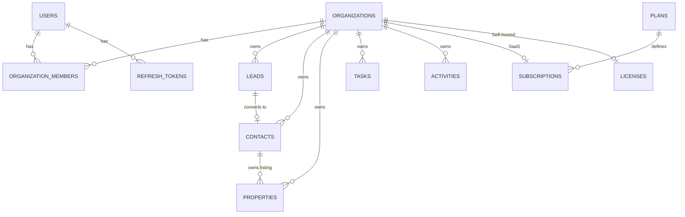

# Database Schema (MongoDB / Mongoose)

## Global conventions
- `timestamps: true` on all schemas (except append-only: Activities/AuditLogs use `createdAt` only).
- `_id` is ObjectId; references use `ref`.
- Org-owned collections always have `organizationId` (required, indexed, first field in compound indexes).
- Emails are lowercased and trimmed. Enums are defined in `packages/shared` and reused in Mongoose.
- Business entities use **soft delete** (`deletedAt`); hard deletes are admin-only retention jobs.
- No plaintext passwords, tokens, or license keys are stored. Only hashes.

## Changes from the original brief (additive, no conflicts)
| Addition | Reason |
|---|---|
| `RefreshTokens` collection | Needed for rotation, reuse detection, and revocation |
| `Invitations` collection | Invites for users who may not exist yet (token hash, expiry) |
| `WebhookEvents` collection | Idempotent billing event processing |
| `Users.platformRole` | Separates platform admin from org roles |
| `deletedAt` on Leads/Contacts/Properties/Tasks | Preserves history, prevents accidental loss |
| `OrganizationMembers.status` + permission overrides | Supports suspension and custom permissions |
| `Leads.convertedContactId`, `wonAt`, `lostAt`, `lostReason` | Lifecycle history |
| `Plans.trialDays`, `Subscriptions.trialEndsAt`, `graceEndsAt` | Trial and grace periods |

## Collection scope
| Collection | SaaS | Self-hosted | Notes |
|---|---|---|---|
| Users, Organizations, OrganizationMembers, Invitations, RefreshTokens | Yes | Yes | Shared |
| Leads, Contacts, Properties, Tasks, Activities, Notifications, AuditLogs | Yes | Yes | Shared |
| Plans, Subscriptions, WebhookEvents | Yes | No | SaaS only |
| Licenses | No | Yes | Self-hosted only |

## Core collections

### Users
| Field | Type | Rules |
|---|---|---|
| name | String | required, 2-100 |
| email | String | required, unique, lowercase |
| passwordHash | String | required, `select: false` (argon2id or bcrypt) |
| avatar, phone | String | optional |
| status | Enum | ACTIVE, SUSPENDED, DELETED |
| emailVerified | Boolean | default false |
| platformRole | Enum | NONE (default), PLATFORM_ADMIN |
| tokenVersion | Number | bump to invalidate all sessions |
| lastLoginAt | Date | |

Indexes: `{email:1}` unique.

### Organizations
name, slug (unique, lowercase), logo, email, phone, address `{line1, city, state, country, postalCode}`,
ownerId -> Users, timezone (IANA), currency (ISO 4217), status (ACTIVE, SUSPENDED, DELETED).
Indexes: `{slug:1}` unique, `{ownerId:1}`.

### OrganizationMembers
organizationId, userId, role (OWNER, ADMIN, MANAGER, AGENT), `permissions` (extra grants, string[]),
`deniedPermissions` (string[]), invitationStatus (PENDING, ACCEPTED, DECLINED, REVOKED),
status (ACTIVE, SUSPENDED), joinedAt.
Indexes: `{organizationId:1, userId:1}` **unique**, `{userId:1}`, `{organizationId:1, role:1}`.
Rule: exactly one OWNER per organization (enforced in service, verified by partial unique index
`{organizationId:1}` where `role:'OWNER'`).

### Leads
| Field | Notes |
|---|---|
| organizationId | required |
| assignedTo | -> Users (must be an active member; validated in service) |
| firstName, lastName, email, phone, alternatePhone | phone normalized to E.164 where possible |
| leadSource | Enum: WALK_IN, REFERRAL, WEBSITE, FACEBOOK, INSTAGRAM, WHATSAPP, PORTAL, CALL, OTHER |
| leadType | BUYER, SELLER, TENANT, LANDLORD, INVESTOR |
| status | NEW, CONTACTED, QUALIFIED, MEETING_SCHEDULED, NEGOTIATION, WON, LOST |
| priority | LOW, MEDIUM, HIGH, URGENT |
| budget | `{min, max, currency}` |
| preferredLocation | String[] |
| interestedPropertyType | PropertyType[] |
| notes | String (max 5000) |
| nextFollowUpAt | Date |
| convertedContactId, wonAt, lostAt, lostReason | lifecycle |
| createdBy, deletedAt | |

Indexes: `{organizationId:1, status:1, createdAt:-1}`, `{organizationId:1, assignedTo:1, status:1}`,
`{organizationId:1, nextFollowUpAt:1}` (partial: status not WON/LOST), `{organizationId:1, phone:1}`,
`{organizationId:1, email:1}` (sparse), text index on `firstName, lastName, email, phone`
(prefix `organizationId` is applied in queries).

### Contacts
organizationId, leadId (optional), firstName, lastName, email, phone, address, contactType
(CLIENT, OWNER, TENANT, LANDLORD, PARTNER, OTHER), assignedTo, notes, deletedAt.
Indexes: `{organizationId:1, phone:1}`, `{organizationId:1, assignedTo:1}`, `{organizationId:1, leadId:1}`.

### Properties
organizationId, title, description, propertyType (HOUSE, APARTMENT, PLOT, COMMERCIAL, OFFICE,
FARMHOUSE, OTHER), listingType (SALE, RENT), price (stored as integer minor units or Decimal128),
currency, location `{type:'Point', coordinates}` (optional), address, city, area, bedrooms,
bathrooms, areaSize, areaUnit (SQFT, SQM, MARLA, KANAL, ACRE), features String[],
images `[{url, key, isPrimary}]` (max 20), listingStatus (AVAILABLE, RESERVED, SOLD, RENTED, INACTIVE),
ownerContactId, assignedTo, createdBy, deletedAt.
Indexes: `{organizationId:1, listingStatus:1, listingType:1, createdAt:-1}`,
`{organizationId:1, city:1, area:1}`, `{organizationId:1, price:1}`, `{organizationId:1, assignedTo:1}`,
`2dsphere` on `location` (optional).

### Tasks
organizationId, title, description, taskType (CALL, EMAIL, MEETING, VIEWING, FOLLOW_UP, DOCUMENT, OTHER),
assignedTo, relatedLeadId, relatedContactId, relatedPropertyId, dueDate, priority,
status (OPEN, IN_PROGRESS, DONE, CANCELLED), completedAt, createdBy, deletedAt.
Indexes: `{organizationId:1, assignedTo:1, status:1, dueDate:1}`, `{organizationId:1, relatedLeadId:1}`,
`{organizationId:1, relatedContactId:1}`, `{organizationId:1, relatedPropertyId:1}`.

### Activities (append-only)
organizationId, userId, entityType (LEAD, CONTACT, PROPERTY, TASK), entityId, activityType
(CALL, EMAIL, MEETING, NOTE, STATUS_CHANGE, FOLLOW_UP, PROPERTY_VIEWING, OTHER), description,
metadata (Mixed, size-limited), createdAt.
Indexes: `{organizationId:1, entityType:1, entityId:1, createdAt:-1}`, `{organizationId:1, userId:1, createdAt:-1}`.

### Notifications
organizationId, userId, title, message, type (TASK_DUE, LEAD_ASSIGNED, FOLLOW_UP, SYSTEM, BILLING),
relatedEntityType, relatedEntityId, readAt, createdAt.
Indexes: `{organizationId:1, userId:1, readAt:1, createdAt:-1}`; TTL on `createdAt` (e.g., 180 days).

## Security collections

### RefreshTokens
userId, familyId (UUID), tokenHash (SHA-256, unique), expiresAt, revokedAt, replacedByHash,
userAgent, ip, createdAt.
Indexes: `{tokenHash:1}` unique, `{userId:1, familyId:1}`, TTL on `expiresAt`.

### Invitations
organizationId, email, role, tokenHash (unique), invitedBy, expiresAt, acceptedAt, revokedAt.
Indexes: `{tokenHash:1}` unique, `{organizationId:1, email:1}`, TTL on `expiresAt` (after retention).

### AuditLogs (append-only)
organizationId (nullable for platform actions), actorId, action (e.g., `member.role_changed`),
resource, resourceId, metadata `{before, after, ip, userAgent, requestId}`, createdAt.
Indexes: `{organizationId:1, createdAt:-1}`, `{organizationId:1, resource:1, resourceId:1}`, `{actorId:1, createdAt:-1}`.
Never contains secrets or full PII beyond identifiers. Application code exposes no update/delete.

## Commercial collections

### Plans (SaaS)
name, slug (unique), description, price (minor units), currency, billingInterval (MONTH, YEAR),
trialDays, features (`{key: boolean}`), limits (`{users, leads, properties, storageMb}`; `null` = unlimited),
providerPlanRefs (`{gumroad?, lemonsqueezy?}`), isActive.

### Subscriptions (SaaS)
organizationId (unique), planId, status (TRIALING, ACTIVE, PAST_DUE, CANCELED, EXPIRED),
billingProvider (GUMROAD, LEMONSQUEEZY, NONE), providerCustomerId, providerSubscriptionId,
trialEndsAt, currentPeriodStart, currentPeriodEnd, graceEndsAt, cancelAtPeriodEnd.
Indexes: `{organizationId:1}` unique, `{providerSubscriptionId:1}` sparse unique, `{status:1, currentPeriodEnd:1}`.

### WebhookEvents (SaaS)
provider, providerEventId, type, payloadHash, receivedAt, processedAt, status (RECEIVED, PROCESSED, FAILED).
Indexes: `{provider:1, providerEventId:1}` unique (idempotency).

### Licenses (self-hosted)
organizationId, licenseKeyHash (SHA-256 of key; unique), keyLast4, edition (STANDARD, PROFESSIONAL, AGENCY),
status (INACTIVE, ACTIVE, EXPIRED, REVOKED), activatedAt, expiresAt, lastValidatedAt, offlineGraceUntil,
maxUsers, instanceFingerprint, metadata.
Indexes: `{licenseKeyHash:1}` unique, `{organizationId:1}`.

## Relationship diagram

## Validation requirements
- All inputs validated by Zod at the API edge; Mongoose validators are a second line of defense.
- Cross-document references (assignedTo, ownerContactId, related*Id) must be verified to
  belong to the **same organization** in the service layer.
- Max lengths on all strings; arrays are capped (images 20, features 50).

## Tenant isolation
Defined in `MULTI_TENANCY.md`. In short, every org-owned model is accessed through a
tenant-scoped repository helper that injects `organizationId` into every filter.