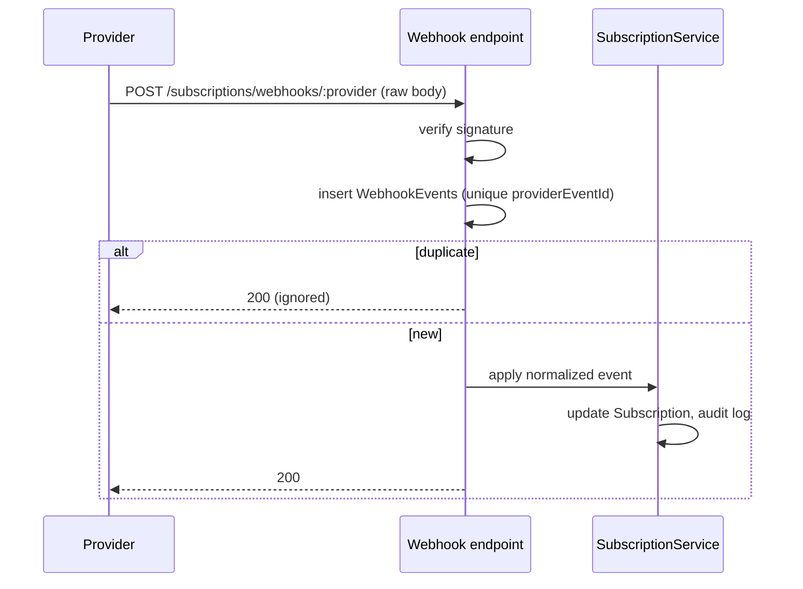

# SaaS and Self-Hosted Editions

## Principle
One codebase. Commercial differences live behind two interfaces and are selected by
validated server-side `DEPLOYMENT_MODE`. CRM modules never branch on mode.

| Concern | Interface | SaaS impl | Self-hosted impl |
|---|---|---|---|
| Entitlements and limits | `EntitlementProvider` | `SubscriptionEntitlementProvider` | `LicenseEntitlementProvider` |
| Payments | `BillingProvider` | Gumroad / Lemon Squeezy adapters | Not used |
| Routes mounted | `commercial/index.ts` | `/subscriptions`, `/admin` | `/licenses` |

Route modules for the inactive edition are not mounted (they return 404).

## SaaS architecture
- Registration creates a user, an organization, an OWNER membership, and a TRIALING subscription.
- **Trial:** `trialDays` from the plan; at expiry status becomes EXPIRED unless paid.
- **Plans:** monthly and annual (`billingInterval`); features and limits stored on `Plans`.
- **States:** TRIALING, ACTIVE, PAST_DUE (grace period), CANCELED (access until period end), EXPIRED.
- **Grace:** on payment failure, `graceEndsAt = now + N days`; read/write continues, with banner.
  After grace: read-only mode (data is never deleted automatically).
- **Enforcement points:** `entitlement guard` middleware (feature flags) and `assertWithinLimit`
  in services (users, leads, properties, storage).

### BillingProvider interface
```ts
interface BillingProvider {
  name: 'GUMROAD' | 'LEMONSQUEEZY';
  verifyWebhook(rawBody: Buffer, headers: Headers): boolean;      // signature check
  parseEvent(rawBody: Buffer): NormalizedBillingEvent;            // provider -> internal
  createCheckoutUrl(input: CheckoutInput): Promise<string>;
}
type NormalizedBillingEvent =
  | { type: 'SUBSCRIPTION_CREATED' | 'SUBSCRIPTION_UPDATED' | 'SUBSCRIPTION_CANCELED'
          | 'PAYMENT_SUCCEEDED' | 'PAYMENT_FAILED' | 'REFUNDED'; eventId: string; ... };
```
### Webhook processing

**A checkout success redirect never changes billing state.** Only verified webhook events do.
Provider-specific field mapping stays inside adapters. Core code uses normalized events only.
Gumroad and Lemon Squeezy differ in webhook formats and capabilities, so each adapter must be
validated against that provider's current docs when implemented (Phase 8).

## Self-hosted architecture
- Customer receives a license key at purchase. On first run, setup wizard creates the admin and organization.
- **Activation:** `POST /licenses/activate` sends key + instance fingerprint to the license service
  (or validates a signed license file offline). Server stores `sha256(key)`, never the key.
- **Validation:** periodic check (e.g., daily) updates `lastValidatedAt`.
- **Offline grace:** if validation can't reach the license server, the app continues until
  `offlineGraceUntil` (e.g., 14 days), then enters read-only mode with a clear message.
- **Limits:** `maxUsers` enforced when inviting/accepting members; edition controls feature flags.
- **Expiry:** status EXPIRED means read-only with export still allowed. Data stays accessible to the customer.
- The license module is replaceable. Only `LicenseEntitlementProvider` depends on it.
- Honest note: license checks in self-hosted software can be bypassed by determined users. The design aims
  for reasonable protection (signed licenses, server-side checks), not DRM.

## Docker Compose (target for Phase 9)
Services: `web` (nginx serving the build), `api`, `mongo` (with volume). Config via `.env`.
Healthchecks on all services; `mongo` not exposed publicly; first-run setup wizard.

## Configuration matrix
| Variable | SaaS | Self-hosted |
|---|---|---|
| DEPLOYMENT_MODE | `SAAS` | `SELF_HOSTED` |
| BILLING_PROVIDER, webhook secrets | Required | Ignored |
| LICENSE_* | Ignored | Required |
| Registration | Open (with trial) | First-run only, then invite-only |