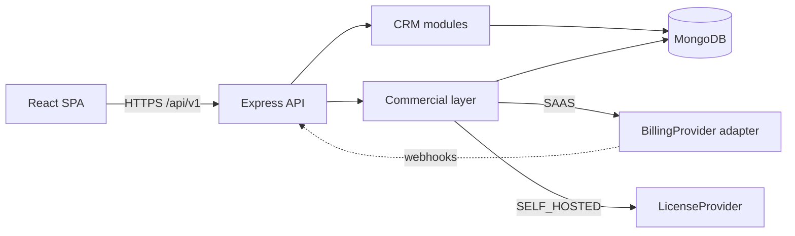
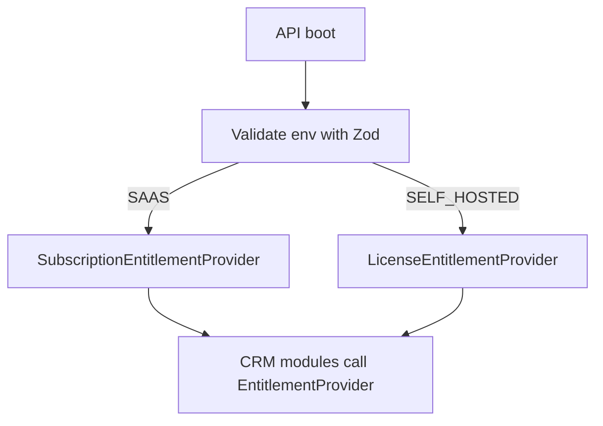
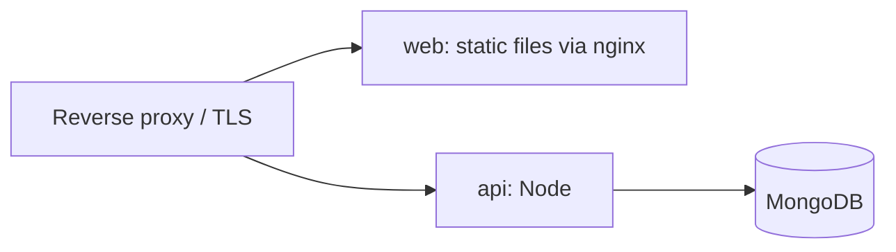

# System Architecture

## 1. Style: modular monolith
One deployable API, one SPA, one MongoDB. Modules are isolated by folder and by dependency
rules (see below), so extraction into services is possible later but not planned.



## 2. Layers and dependency rules
```
routes -> controllers -> services -> models
                          |
                          +-> entitlements (interface only)
```
- Controllers handle HTTP only (parse, call service, shape response).
- Services contain business logic and are framework-free (no `req`/`res`).
- Models contain schema, indexes, validation.
- **CRM modules may import `entitlements` and `audit`, never `billing` or `licensing`.**
- `packages/shared` is imported by both apps; it contains no Node- or browser-specific code.

## 3. Backend architecture
```
apps/api/src/
  config/          env validation (Zod), deployment mode, constants
  middleware/      authenticate, resolveOrganization, requireMembership,
                   authorize, entitlement guard, validate, rateLimit, errorHandler
  modules/
    auth/ users/ organizations/ members/ leads/ contacts/ properties/
    tasks/ activities/ notifications/ analytics/ audit/
    commercial/
      entitlements/     EntitlementProvider interface + factory
      subscriptions/    SaaS only
      licensing/        Self-hosted only
      billing/          BillingProvider interface + adapters
    admin/              platform administration (SaaS)
  utils/ types/ app.ts server.ts
```
Each CRM module contains `*.routes.ts`, `*.controller.ts`, `*.service.ts`, `*.model.ts`,
`*.validators.ts`. Modules only create the files they need.

## 4. Frontend architecture
```
apps/web/src/
  components/   ui/ (shadcn), shared presentational components
  features/     auth, leads, contacts, properties, tasks, analytics, settings
                (each: components, hooks, services, types)
  layouts/      AuthLayout, AppLayout
  pages/        route-level components, thin
  routes/       router config, guards
  hooks/ services/ (api client) types/ utils/
```
- Server state: TanStack Query. Forms: React Hook Form + Zod schemas from `packages/shared`.
- The access token lives **in memory only**. The refresh token is an httpOnly cookie.
- The UI may hide features based on entitlements, but the **server is the authority**.

## 5. Deployment modes
`DEPLOYMENT_MODE` is validated at boot with Zod. Invalid or missing values stop startup.
The frontend learns about the mode from `GET /api/v1/system/config` for UI display only;
it is never sent back or trusted.



## 6. Entitlement abstraction
```ts
interface EntitlementProvider {
  getEntitlements(orgId: string): Promise<Entitlements>; // status, features, limits
  assertFeature(orgId: string, feature: string): Promise<void>;
  assertWithinLimit(orgId: string, limit: 'users' | 'leads' | 'properties', delta?: number): Promise<void>;
}
```
CRM services call this interface and never know which edition is running.

## 7. Deployment topology

- **SaaS:** managed host or container platform + managed MongoDB (e.g., Atlas), CI/CD from GitHub.
- **Self-hosted:** `docker compose up` runs `web`, `api`, `mongo` with a `.env` file.

## 8. Key decisions
| Decision | Reason |
|---|---|
| Modular monolith | Small team, simpler ops, enough scalability |
| Shared Zod schemas | One validation source for client and server |
| Entitlement interface | Keeps commercial logic out of CRM code |
| Single-DB, `organizationId` multi-tenancy | Works for both editions; cheapest to operate |
| Access token in memory + httpOnly refresh cookie | Reduces XSS token theft |